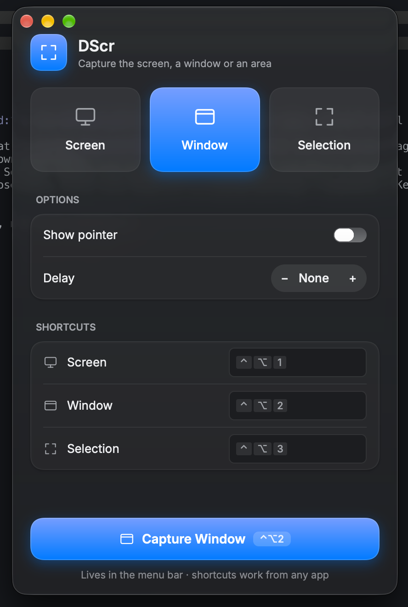

# DScr

A small screenshot tool for macOS, in the spirit of Linux Mint's Screenshot app. Built with
[Rune](https://github.com/anomalyco/rune).

Pick what to capture, set a delay, and take the shot from the window, the menu bar or a global
keyboard shortcut. The result opens in a preview where you can save it, copy it or throw it away.

<p align="center"></p>

## Features

- **Three capture modes:** the whole screen, a window (click the one you want), or a selection you drag out.
- **Options:** show the mouse pointer, and a delay of 0–60 seconds.
- **Global shortcuts** for each mode. They work from any app, even with the window closed.
  The defaults are ⌃⌥1 (screen), ⌃⌥2 (window) and ⌃⌥3 (selection), and you can record your own.
- **Preview** after every capture:
  - **Save…** writes a PNG where you choose, then closes the preview.
  - **Copy** puts the image on the clipboard and leaves the preview open.
  - **Cancel** closes it.
- **Menu bar app:** launches straight into the menu bar with no window and no Dock icon (turn on **Open window at launch** to show the window too).
  Click the menu-bar icon for the menu:
  Open DScr, the three capture modes, and Quit. Closing the window keeps the app running.
- **One instance:** launching it again brings up the running copy's settings window.
- Liquid Glass styling on macOS 26 and later; light and dark mode follow the system.

## Build your own

There are no prebuilt releases: you build DScr from source on your own Mac. It takes a few
minutes the first time, mostly compiling Rune and its graphics stack.

### 1. Install the tools

- **macOS** (Liquid Glass needs macOS 26; older versions get a frosted look instead).
- **Xcode Command Line Tools**, for the compiler, `codesign` and `plutil`:

  ```sh
  xcode-select --install
  ```

- **Rust 1.89 or newer**, through [rustup](https://rustup.rs):

  ```sh
  curl --proto '=https' --tlsv1.2 -sSf https://sh.rustup.rs | sh
  ```

  Already have it? `rustup update` brings it up to date.

### 2. Get the code

```sh
git clone <this repository's URL> dscr
cd dscr
```

### 3. Try it

```sh
cargo run --release
```

Nothing opens: DScr goes straight to the menu bar. Click its icon (corner brackets around a
dot) to open the window. Run this way, macOS asks for Screen Recording permission on behalf
of your **terminal**, not DScr.

### 4. Make it a real app

```sh
./scripts/bundle.sh
```

This builds a release binary and wraps it in `target/DScr.app`. The bundle is ad-hoc signed,
which needs no Apple Developer account. Then install it:

```sh
cp -R target/DScr.app /Applications/
open /Applications/DScr.app
```

### 5. Grant Screen Recording permission

The first capture triggers the macOS prompt. If you miss it, go to System Settings → Privacy &
Security → Screen Recording, turn on **DScr**, then quit DScr from its menu and open it again.
Without this permission, captures show only your wallpaper. Global shortcuts need no
permission.

### 6. Start it at login (optional)

System Settings → General → Login Items → **+** under "Open at Login" → choose DScr.

### Updating

```sh
git pull
./scripts/bundle.sh
```

Quit DScr from its menu, copy the new bundle over the old one in `/Applications`, and open it.
Every build gets a new ad-hoc signature, so **macOS treats it as a new app**: Screen Recording
may show DScr turned on but captures still come back as wallpaper. If so, select DScr in that
list, remove it with **−**, and grant permission again on the next capture.

### Uninstalling

Quit DScr from its menu, then:

```sh
rm -rf /Applications/DScr.app ~/Library/Application\ Support/dev.tbdsux.dscr
```

Also remove it from Login Items and from the Screen Recording list if you added it there.

## Settings

Settings are saved in `~/Library/Application Support/dev.tbdsux.dscr/prefs.json`: mode,
pointer, delay and shortcuts. The same folder holds the single-instance lock and socket.

## Known limits

- **Show pointer:** only applies to Screen captures. macOS ignores it for Window and Selection.
- **Several displays:** Screen captures only the main display.
- **Window mode:** you click the window to capture. It doesn't grab the active window automatically.

## Testing

```sh
cargo test
```

GitHub Actions runs the same on a macOS runner for every push to `main` and every pull request
(`.github/workflows/ci.yml`).

Rune apps can also render headless, which is handy for checking the UI without a display:

```sh
cargo run -- --snap main.png                     # settings window
cargo run -- --window preview --snap preview.png # preview window
```

## License

[MIT](LICENSE) © 2026 Joshue Abance
